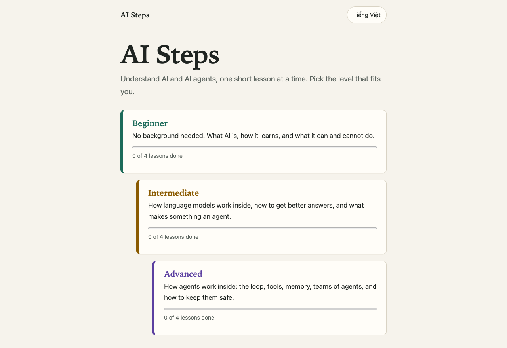

# AI Steps

Learn about AI and AI agents in short lessons with quizzes, at three levels
(Beginner, Intermediate, Advanced), in English and Vietnamese.

Live site: https://vanmanh49.github.io/ai-steps/



## Run locally

```bash
npm install
npm run dev
```

`npm test` runs the checks. `npm run build` writes the static site to `dist/`.

## Publish

The site is served by GitHub Pages from the `gh-pages` branch, which holds the
contents of `dist/`:

```bash
npm run build
cd dist
git init -b gh-pages
git add -A
git commit -m "Publish site"
git push -f https://github.com/vanmanh49/ai-steps.git gh-pages
```

## Adding a lesson

Add the lesson to both `src/content/en.js` and `src/content/vi.js` with the same
id, question count and answer positions, and add an illustration under the same
id in `src/LessonArt.jsx`. Add the id to the expected list in
`src/content/content.test.js`; `npm test` fails if the two languages drift apart.
